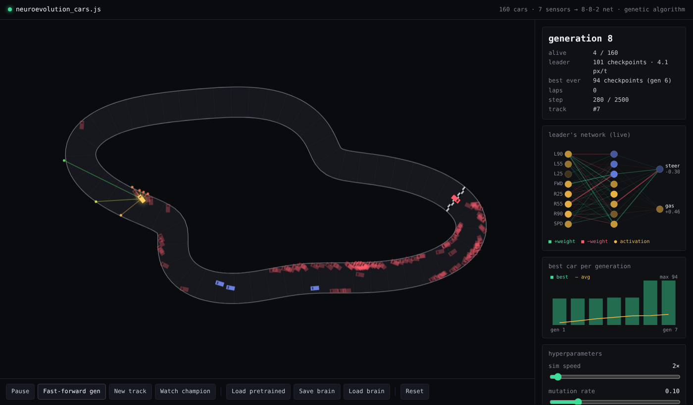
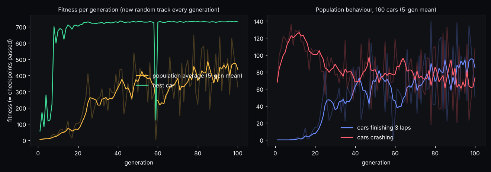
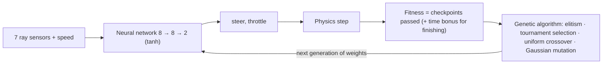

# Neuroevolution Cars: Self-Driving Cars That Teach Themselves

A population of 160 cars learns to race around procedurally generated tracks **with no training data and no hand-written driving rules**. Each car is controlled by a small neural network, and a **genetic algorithm** evolves the networks over generations: the cars that drive furthest pass their "brains" on (with mutation and crossover) to the next generation.

The neural network, genetic algorithm, physics, ray-cast sensors and track generator are all **written from scratch in plain JavaScript, with zero dependencies**.



> **Live demo:** _add your GitHub Pages link here_ · open `index.html` or `dist/neuroevolution-cars.html` in any browser to run it locally.

---

## Results

| Experiment | First full lap | Completes 3 laps on 20 **never-seen** tracks |
|---|---|---|
| Trained on a single track (baseline) | generation 2 | **4 / 20 (20%)**, overfits to its training track |
| Trained on a new random track every generation + validation-based model selection | generation 4 | **17 / 20 (85%)** |

*Setup: 160 cars, 8-8-2 network (90 parameters), 100 generations, seed 42. Full training takes about 110 s in Node. The browser demo on the default track (#7) completes its first lap at generation 8.*



**Main takeaway:** a driver evolved on one track memorises that track. Training on a new random track every generation, and choosing the final model on a separate **validation set** of tracks, raised the completion rate on held-out **test** tracks from 20% to 85%. This is the classic overfitting / train-validation-test split problem, shown in a reinforcement-learning-style setting.

Reproduce with:

```bash
npm run train                       # generalist: random tracks, 20 validation + 20 test tracks
node scripts/train.js --generations 100 --track 42 --val-tracks 0 --test-tracks 20   # single-track baseline
```

---

## How it works



1. **Perception:** each car casts 7 rays (−90° to +90°). Each reading is normalised to [0, 1] (1 = wall touching). Current speed is the 8th input.
2. **Decision:** a fully connected feed-forward network (8 → 8 → 2, tanh activations) outputs **steering** and **throttle/brake**. All 90 weights and biases are stored in one flat `Float32Array`, the *genome*.
3. **Physics:** a simple kinematic model with acceleration, friction, a speed cap and speed-dependent turning, so cars must learn to **brake before tight corners**.
4. **Fitness:** the track has 220 checkpoint gates. Fitness = gates passed + fractional progress to the next gate, plus a time bonus for finishing 3 laps (this rewards speed, not just survival). Cars die on wall contact or after 100 steps without progress, which kills cars that stand still or spin in circles.
5. **Evolution:** when every car has died, the GA builds the next generation:
   - **Elitism:** the top 4 genomes survive unchanged, so the best solution is never lost.
   - **Tournament selection (k = 4):** keeps selection pressure stable without fitness scaling.
   - **Uniform crossover (50%)** mixes two parents' weights.
   - **Gaussian mutation** (rate 0.10, σ = 0.35) plus occasional full gene resets to keep diversity.
6. **Generalisation:** optionally a brand-new procedural track is generated every generation, so the network has to learn *how to drive* instead of memorising one track.

### Engineering details
- **Procedural tracks:** an ellipse distorted by random sine harmonics, resampled to equal arc length and **validated** (no folded walls, no touching road sections). Invalid tracks are regenerated with gentler curves.
- **Fast geometry:** ray casts and collisions only test wall segments near the car's current checkpoint index (a local window instead of all 440 walls), which makes fast-forward training practical in the browser.
- **Fully reproducible:** every random choice goes through a seeded PRNG (mulberry32), so the same seed always gives the same run.
- **One engine, two runtimes:** the simulation core has no rendering code, so the same files run in the browser (visual) and in Node (headless training: 100 generations in under 2 minutes).
- **Unit tested:** 11 tests using Node's built-in runner, covering the NN maths, GA invariants (elitism, selection pressure), track validity across 40 seeds, ray-cast accuracy, a "no cheating laps" physics check, learning progress, and save/load round-trips.

---

## Features
- Live dashboard: generation, alive count, leader stats, **live view of the leader's neural network** (activations + weights), best-per-generation chart
- Sensor-ray visualisation (green = far, red = close)
- **Fast-forward** a whole generation, adjustable sim speed (1–30×)
- **Watch champion:** replay the best brain ever found, on any track
- **Save / load brains** as JSON, plus a **pretrained champion** you can load with one click
- Live-tunable hyperparameters (mutation rate/strength); population, network size and seed apply on reset
- Toggle "new random track every generation" to see generalisation happen live
- Keyboard shortcuts: `Space` pause · `T` fast-forward · `N` new track · `C` champion · `R` reset

## Run it

```bash
# just open it
open index.html                      # or double-click; no server or install needed

# or with npm (Node 18+)
npm test                             # run unit tests
npm run train                        # headless training -> models/champion.json + results/history.csv
npm run build                        # single-file bundle -> dist/neuroevolution-cars.html
npm start                            # local static server
```

**Deploy to GitHub Pages:** push the repo, then go to Settings → Pages → deploy from the `main` branch root. `index.html` is the entry point.

## Project structure

```
src/
  rng.js       seeded PRNG + Gaussian sampling
  nn.js        feed-forward neural network (flat genome)
  ga.js        genetic algorithm (elitism, tournament, crossover, mutation)
  track.js     procedural track generation, validation, ray casting, collisions
  car.js       car physics, sensors, fitness
  sim.js       population / generation loop (render-free, runs in Node too)
  render.js    canvas drawing: track, cars, live network, chart
  app.js       UI, controls, save/load
scripts/
  train.js     headless trainer with validation + held-out test tracks
  build.js     bundles everything into one HTML file
tests/         unit tests (node --test)
models/        pretrained champion (JSON + JS wrapper for file:// loading)
results/       training logs (CSV) + single-track baseline brain
docs/          screenshot + learning curve
```

## Ideas for future work
- NEAT (evolving network topology as well as weights)
- Compare against gradient-based RL (e.g. PPO or DQN) on the same environment
- Multi-objective fitness (speed vs. smoothness), novelty search
- Track editor so you can draw your own track

## License
MIT

---

## Resume / portfolio material

**Project title:** Neuroevolution Self-Driving Car Simulator | JavaScript, Neural Networks, Genetic Algorithms, HTML5 Canvas, Node.js

**Resume bullets (pick 2–3):**
- Built a self-driving car simulator in which 160 agents learn to race with **no training data**, using a **from-scratch neural network (8-8-2) evolved by a genetic algorithm** (elitism, tournament selection, uniform crossover, Gaussian mutation), with zero ML libraries.
- Diagnosed **overfitting** (20% success on unseen tracks) and fixed it with **procedurally generated training tracks plus validation-based model selection**, reaching **85% completion on 20 held-out test tracks**.
- Designed a render-free simulation core shared by a real-time **browser dashboard** (live neural-network visualisation, fitness charts, champion replay) and a **headless Node.js trainer** (100 generations in under 2 minutes); made experiments fully reproducible with a seeded PRNG.
- Optimised ray-cast sensing and collision detection with **spatially local wall queries**, enabling fast-forward training of 160 cars × 7 sensors in real time; covered the core with **11 unit tests**.

**Short version (one line):** Self-driving car simulator where neural networks evolve via a from-scratch genetic algorithm. Improved generalisation to unseen tracks from 20% to 85% using procedural training tracks and validation-based model selection.

**Interview talking points**
- *Why a genetic algorithm instead of backpropagation?* There are no labels. The only signal is "how far did the car get", which is sparse, delayed and non-differentiable. Neuroevolution optimises that reward directly, without gradients.
- *Why tournament selection?* It is insensitive to the scale of the fitness values (the time bonus makes the scale jump), unlike fitness-proportional "roulette" selection.
- *Why elitism?* Without it, mutation can destroy the best solution and progress goes backwards.
- *Overfitting in RL:* a single-track champion memorised that track's corners. Randomised tracks act as data augmentation, and a separate validation set stops the test score from being optimistically biased.
- *Limitations:* uniform crossover of neural networks can be destructive (the "competing conventions" problem). NEAT handles this with historical markings.
